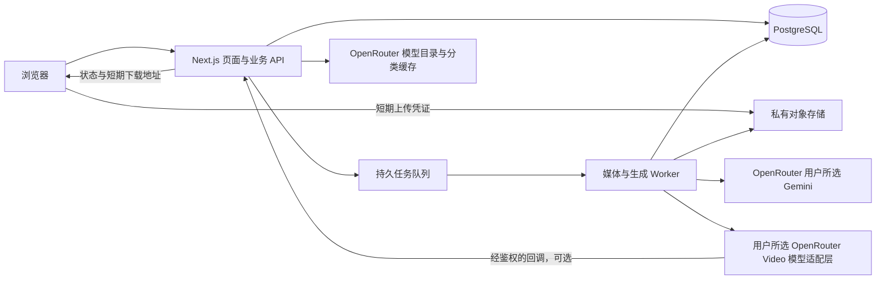

# Next.js 技术架构与接口设计

## 技术选型提案

前端及业务 API 使用 Next.js App Router 与 TypeScript，交互组件使用 React。页面与基础布局采用服务端渲染，上传、时间轴、播放器和进度刷新使用客户端组件。样式建议 Tailwind CSS 配合可访问的无样式交互组件；具体依赖和稳定版本在实施前核验、固定，不预设未经核实的版本号。

持久化使用 PostgreSQL；私有对象存储使用兼容 S3 的服务。独立 Worker 处理媒体与供应商任务，使用具备持久化、重试及死信能力的托管任务队列。认证、队列、存储和数据库的具体供应商在部署地区与预算确认后选定，避免在设计阶段假设某个平台的限制。

首版采用单一业务服务加独立任务 Worker，无需拆成多个微服务。Next.js 服务可用托管 Node.js 或容器部署；媒体任务不放在页面请求、Edge Runtime 或进程内后台承诺中执行。

## 正常数据流

1. 浏览器本地检查格式、大小并展示预览，登录前不上传到远端。
2. 用户登录后申请带单个对象、大小及过期限制的上传凭证，直传私有存储。服务端记录资产归属并再次核验真实对象大小。
3. 链接导入走服务端资产任务：先防 SSRF 检查，再流式抓取到隔离区，限制下载字节数、重定向、超时和网络目标。
4. Worker 校验文件签名、解码媒体、移除元数据、裁剪舞蹈片段和生成分析副本。宠物素材支持本地或 URL 图片/视频；宠物视频按用户选定时间抽取代表帧，保留源资产关联。所有媒体处理有限 CPU、内存、磁盘、像素总量与执行时长。
5. 服务端读取 OpenRouter 目录并返回两个下拉列表：Text 输出中的 Gemini、Video 输出模型。素材就绪后生成有到期时间的报价，固定输入、两个所选模型 ID、目录快照版本、参数、能力等级、供应商配置版本及消耗上限。
6. 用户确认后，服务端验证报价仍有效、素材归属、并发上限和额度；在同一数据库事务中创建任务、预留额度及待投递事件，再由投递器推送队列。
7. Worker 准备素材和版本化基础提示词，通过 OpenRouter 调用用户所选 Gemini 再加工，校验成功后才将最终提示词、身份图与参考舞蹈视频提交用户所选视频模型。保存每次 OpenRouter 调用 ID、所选与实际执行模型、用量及视频任务号；未知、已失效或未核实的模型 ID 阻止执行，不自动替换。
8. 用已验证回调或定时查询推进任务；不能以浏览器是否在线决定是否继续。
9. 取回供应商视频到自有私有存储，校验、转码和生成封面；事务性地结算额度并标记成功。
10. 浏览器前台按约 3 秒轮询，逐步放慢至约 10 秒；隐藏页面暂停轮询，重新可见立即刷新。目标间隔以限流与实际时延调整。产物完成和用量结算分开跟踪：视频可预览时立即开放结果，用量待确认则后台继续补齐，结果页自动更新费用面板。

API 请求只负责接受工作并返回任务标识。视频下载、FFmpeg 和长时间等待均在隔离 Worker 中执行。供应商下载链接不直接作为长期作品地址。

## 任务状态机

资产检查属于独立的预处理任务；生成任务在素材可用和报价确认后创建。

| 内部状态 | 含义 | 可转向 |
| --- | --- | --- |
| queued | 已接受并待分析 | analyzing、cancelled、failed |
| analyzing | 生成结构化外观与动作描述 | submitting、cancelled、failed |
| submitting | 正在向供应商提交 | provider_queued、generating、reconciling、failed |
| provider_queued | 供应商已受理，等待执行 | generating、processing、reconciling、failed；取消需供应商确认 |
| generating | 供应商执行中 | processing、reconciling、failed |
| processing | 产物取回及转码校验 | succeeded、failed |
| reconciling | 提交结果、超时或费用状态不明确 | provider_queued、generating、processing、failed、cancelled |
| succeeded | 作品就绪且费用已结算 | 终态 |
| failed | 已确认失败并完成对应账务处理 | 终态 |
| cancelled | 已确认停止且完成对应账务处理 | 终态 |

供应商直接返回完成可跳过中间展示阶段。最终状态不能被迟到回调覆盖；每次迁移带版本检查并记录事件。媒体清理是单独的资产状态，不将 succeeded 改回 failed；作品可另有 available / expired / deleted 状态。

任务进入 reconciling 后仍持有必要额度预留，页面显示“正在确认结果”，不伪装成已退款。最大排队、生成、对账期限按供应商实测设置；无解的对账进入人工处理队列，并明确用户可追踪的任务编号。

取消与供应商提交之间使用同一任务版本与执行锁协调。提交前可原子取消并退款；已经进入 submitting 时须确认外部结果，不能直接标记取消成功。

## 核心数据

| 实体 | 关键字段和约束 |
| --- | --- |
| User | ID、认证主体、创建时间、账户状态 |
| Asset | owner、类型、角色（宠物/舞蹈/代表帧）、来源（上传/URL）、父资产和选帧时间、私有对象键、媒体元数据、检查状态、到期及删除时间 |
| AssetTask | 导入/预处理阶段、错误码、重试次数；原始 URL 加密或短期保存，日志脱敏 |
| ModelCatalogSnapshot | OpenRouter 原始模型 ID、名称、输出分类、输入能力、系列依据、价格与单位、目录时间和版本；接入可用性另列，不改写来源分类 |
| Quote | owner、输入资产、所选提示词/视频模型 ID、目录及能力版本、选段、风格、画幅、能力等级、配置版本、费用上限、有效期 |
| GenerationJob | owner、两个所选模型 ID 及名称快照、输入和参数快照、报价、状态、供应商任务号、配置版本、幂等键、时间戳 |
| JobEvent | task、状态迁移、原因、关联 ID；不存完整私密输入 |
| PromptRevision | job、基础模板版本、Gemini 调用 ID、准确模型 ID、最终提示词摘要及校验状态；完整文本加密且短期保存，随素材清理 |
| ModelInvocation | job、步骤、请求幂等标识、OpenRouter 调用 ID、实际模型及提供方、输入/输出/总 token、费用数值及单位、结算状态、更新时间 |
| Output | job、私有视频与封面键、实际规格、到期时间、可访问状态 |
| CreditLedger | owner、job、预留/结算/返还类型、金额或额度、唯一事件键；余额变更可审计 |
| OutboxEvent | 与任务事务一起写入的待投递事件、投递状态和次数 |

ModelInvocation 每个外部调用只记账一次；重试和修复对应新的真实调用，均纳入所属任务。未知 token/费用保存为空值，不能填零；金额使用定点小数而非二进制浮点。任务用量聚合按去重后的调用明细计算，补录结算更新原调用而非重复插入。模型声明的缓存或推理 token 可能是已有类别子集，未核实计数语义前不额外叠加。

数据库对用户与幂等键建立唯一约束，对供应商回调事件、扣费和返还事件分别去重。所有按 ID 查询均校验 owner，不能依靠不可猜测的 UUID 代替权限判断。

## API 契约草案

路径与字段为业务设计，不是可直接运行的实现。认证使用 HttpOnly、Secure 会话；所有修改请求具备 CSRF/来源校验及用户和 IP 维度限流。

| 接口 | 请求重点 | 返回与职责 |
| --- | --- | --- |
| GET /api/models?purpose=prompt | 应用自己的查询参数，不是假定的 OpenRouter 参数 | Text 输出分类且属于 Gemini 的目录项、可选状态、原因、价格单位、更新时间及版本 |
| GET /api/models?purpose=video | 应用自己的查询参数 | Video 输出分类目录项、输入兼容性、接入状态、规格、价格单位、更新时间及版本 |
| POST /api/assets/uploads | 角色、图片/视频类型、声明大小、MIME | 资产 ID、限定对象的短期上传凭证 |
| POST /api/assets/{id}/complete | 已完成上传的资产 ID | 202 和预处理任务；检查对象真实大小后入队 |
| POST /api/assets/imports | 角色、HTTPS 图片/视频 URL | 202、资产 ID、导入任务 ID；不在请求中等待下载 |
| GET /api/assets/{id} | 当前用户会话 | 准备状态、可信媒体元数据、可恢复错误 |
| POST /api/assets/{id}/frames | 宠物视频资产、选帧时间 | 202，抽帧任务及派生身份图资产；服务端校验时间范围 |
| POST /api/quotes | 素材 ID、所选提示词/视频模型 ID、选段、风格、画幅 | 服务端重验目录归属、系列、接入和输入兼容后返回绑定模型的报价、到期时间、预计消耗与约束 |
| POST /api/jobs | 报价 ID；请求头携带幂等键 | 202 和任务 ID；同键同内容返回原任务，不同内容返回冲突 |
| GET /api/jobs/{id} | 当前用户会话 | 状态、阶段时间、错误、操作可用性、结果摘要 |
| GET /api/jobs/{id}/usage | 当前用户会话 | 仅该用户任务的 OpenRouter token、credit 明细与结算状态，独立视频费用和应用额度；不返回账号全局余额 |
| GET /api/jobs | 分页游标、状态过滤 | 当前用户作品列表 |
| POST /api/jobs/{id}/cancel | 当前用户会话 | 确认取消或待确认状态，不能谎报取消成功 |
| POST /api/jobs/{id}/download | 当前用户会话 | 仍有权限且文件未过期时发放短期下载地址 |
| DELETE /api/jobs/{id} | 当前用户会话 | 立即撤销应用内访问，202 后台清理；保留最小账务记录 |
| POST /api/providers/{provider}/webhook | 签名、事件 ID、时间戳及任务关联 | 验签、防重放、去重，快速确认，再异步处理 |

所有失败统一提供稳定错误码、适合用户阅读的原因、是否可重试、关联 ID；不向客户端透出供应商密钥、堆栈、完整回调或内部资源地址。未就绪资产返回冲突而非默默启动生成；过期作品下载返回明确过期状态。

模型列表由服务端拉取和缓存，不允许客户端自行提交任意模型 ID 绕过筛选。报价时和任务提交时重验选择；变化后返回“模型已失效/规格已变化，请重新选择或确认”，不接受旧报价。执行前再次检查可用性，若失效则按未提交生成处理并结算已发生费用，不换型号。详细目录规则见模型选择设计。

## 必须落实的边界

### 密钥与隐私

OpenRouter 和生成服务密钥仅在服务端密钥管理中保存，禁止使用公开前缀环境变量传给浏览器。首版由应用持有密钥，不要求普通用户填写 API Key。

默认对象私有。供应商若只能接收公网 URL，只签发最小必要对象的专用短期读取地址，有效期覆盖其实际取数窗口；不可访问时用已验证的直接上传方案。队列等待时避免过早签发；查询参数、签名及源 URL 不进入普通日志。

用户删除后立即阻止新下载并触发清理；已经签发的对象读取地址可能在剩余有效期内仍可用，最长 5 分钟，隐私说明应如实披露。供应商读取地址另按实际窗口管理并撤销或删除源对象；删除中任务不再发布结果，迟到结果也要清理。

### 网络导入

仅允许 HTTPS 和批准端口，拒绝用户信息段、非媒体地址、内网/回环/链路本地/云元数据目标及 IPv4、IPv6 变体。DNS 解析后校验目标，连接绑定已验证地址；每次重定向重新校验，配合网络出口规则处理 DNS 重绑定。

不携带用户 cookie 或 Authorization，不绕过网站访问控制。先限制响应与下载字节数，再验证真实媒体；Content-Type 和 Content-Length 只作辅助。媒体解析放在沙箱容器中，禁止任意协议、远程子资源和 shell 拼接。供应商产物取回也执行出站检查，优先限制为已知供应商存储域。

### 费用与重试

OpenRouter 用量来自实际响应或经官方文档核实的调用明细查询，依据调用 ID 对账，不通过估算 token、价格表推算或整个账号余额差充当任务实际消耗。准确字段、查询接口、延迟、credit 单位与换算关系均待官方核验；逻辑数据模型不假装是已确认的上游 schema。

结果页按任务展示输入、输出、总 token，及 OpenRouter credit 实际扣费，按提示词模型和视频模型分别列示。两个阶段由 OpenRouter 结算时，按唯一调用 ID 将实际费用计入同一 OpenRouter 汇总，不能把视频费用再额外加一次；视频调用不提供 token 时标记不适用/未提供。若上游仅提供货币金额，须使用经核实的官方关系显示 credit 并同时保留币种，不能自定换算。独立结算费用（若后续明确启用）与应用内额度单列；只有在币种一致且来源完整时才显示合计金额。

用量状态为 pending / partial / settled / unavailable，独立于视频任务终态。视频完成但费用未返回时继续受限对账；超出窗口显示暂不可获取并保留排查编号，不把成功视频改为失败，也不以 0 代替未知值。失败、取消且已发生 OpenRouter 调用的任务，同样展示实际费用及独立的额度返还。

预留额度是产品内账务约束，不等于供应商费用可退款。成功时结算，确认失败按事先展示的政策返还用户额度；供应商已经产生而用户未承担的费用计入应用成本。

预处理、状态查询、产物下载可使用有上限的指数退避。付费生成重试只在确定未提交或供应商提供可靠幂等时进行。账号并发初始设为 1，全局并发、日预算及单次费用上限可配置；预算耗尽停止接受新的生成，不中断已扣费任务。

## 保留、可观测性与运维

原始素材 24 小时、作品 7 天，到期后台清理；删除或到期时同步清理分析帧、临时文件与封面。备份、存储生命周期和供应商保留必须纳入实际删除说明，不能承诺无法兑现的瞬时物理删除。

按关联 ID 记录阶段耗时、成功率、供应商错误、排队时长、token 用量、实际费用、预留余额及清理延迟。日志默认不存原始照片、帧、完整提示词或含签名的 URL。对失败率、预算异常、对账滞留、清理滞留与死信任务告警。

部署前分别验证浏览器、Next.js 服务、Worker 与供应商之间的区域、网络可达性及数据传输政策。配置声明完整后，缺少密钥或模型能力的环境禁用提交按钮并提供明确状态，不能用模拟成功混入真实生成流程。
